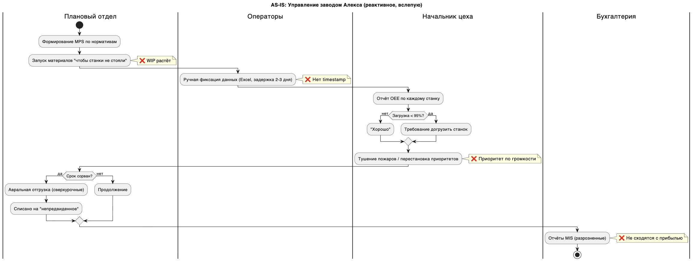
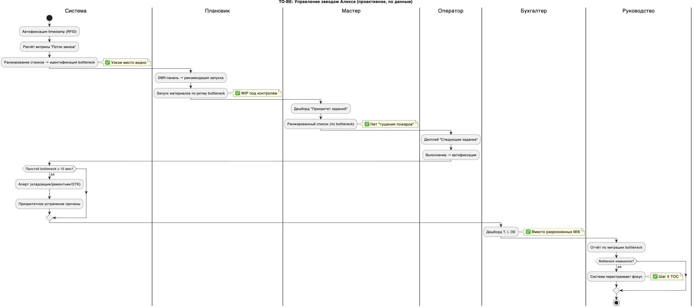

# 03. Анализ AS-IS и TO-BE

## Где принимаются неверные решения

**Ограничение находится не в станке, а в управлении на базе неверных метрик.**

1. Руководство завода измеряет успех по загрузке всех ресурсов (utilization) и эффективности каждого станка (OEE). Это заставляет запускать материалы как можно раньше, чтобы «станки не простаивали».
   **Результат:** гигантский WIP, растущее время цикла, узкое место скрыто за горами запасов.
2. **Неверное решение, принимаемое систематически:** «Запустить новую партию сейчас, потому что станок А освободился», без проверки, успеет ли узкое место её переработать.

**Главное управленческое ограничение:** метрики, не отвечающие цели бизнеса. Оптимизируются локальные оптимумы, хотя завод это система-«цепь», прочность которой определяется самым слабым звеном, то есть бутылочным горлышком.

## Диаграммы процесса управления заводом

AS-IS:

TO-BE:

## Сопоставление AS-IS и TO-BE

| № | AS-IS | TO-BE | Дашборд / метрика | Принцип TOC |
|---|---|---|---|---|
| 1 | Формирование MPS по нормативам, без учёта реальной загрузки | Планирование на основе текущего ритма узкого места (барабан) | Дашборд №3 (DBR): ритм барабана, буфер | Шаг 3: подчинить всё ограничению |
| 2 | Запуск материалов «чтобы станки не стояли» приводит к росту WIP | Запуск материалов по рекомендации DBR (лимит запуска) | Дашборд №3: «Рекомендация запуска» | Шаг 3: верёвка (Rope) |
| 3 | Ручная фиксация данных (Excel, задержка 2–3 дня) | Автоматическая фиксация timestamp (RFID / штрихкод) | Витрина «Поток заказа» | Основа для всех шагов TOC |
| 4 | Неизвестно, где узкое место: управление вслепую | Система автоматически определяет bottleneck по максимальной очереди | Дашборд №1: «Текущее узкое место» | Шаг 1: определить ограничение |
| 5 | Отчётность по OEE для всех станков, локальная эффективность | Фокус только на загрузке и простоях узкого места | Дашборд №1: загрузка bottleneck; дашборд №2: потери Throughput | Шаг 2: максимально использовать ограничение |
| 6 | «Тушение пожаров», приоритет по громкости крика | Ранжированный список заданий по времени прохождения bottleneck | Дашборд №4: «Приоритет заданий» | Шаг 2: загружать ограничение правильными заказами |
| 7 | Простой bottleneck выявляется постфактум | Алерт за 15 минут до простоя (или сразу при простое) | Дашборд №2: причины простоев + система алертов | Шаг 4: развить ограничение |
| 8 | Бухгалтерские отчёты MIS разрознены, не сходятся с прибылью | Единая витрина T, I, OE для глобальной оценки | Дашборд №5: «T, I, OE» | Измерение цели: «делать деньги» |
| 9 | Списание проблем на «непредвиденные простои» | Аналитика причин простоев с привязкой к узкому месту | Дашборд №2: топ-3 причины потерь | Шаг 2: устранить то, что мешает ограничению |
| 10 | Бутылочное горлышко «кочует», но никто этого не отслеживает | Автоматический контроль миграции ограничения | Системный отчёт «Миграция bottleneck» | Шаг 5: вернуться к шагу 1 |
| 11 | Перестановка приоритетов несколько раз в смену, хаос | Стабильный приоритет на основе алгоритма (обновление каждые 5 мин) | Дашборд №4: стабильность приоритетов | Шаг 3: подчинить всё ограничению |
| 12 | Материал подаётся на некритичные станки, bottleneck простаивает | Приоритет подачи материалов: сначала bottleneck, потом всё остальное | Дашборд №4: готовность материала + алерты | Шаг 3: подчинить логистику ограничению |
| 13 | Переналадки на bottleneck не оптимизированы, потери не видны | Визуализация потерь от переналадки на узком месте | Дашборд №2: причина «переналадка» в топ-3 | Шаг 4: развить ограничение |
| 14 | Брак проверяется везде одинаково, без приоритета | Приоритет проверки деталей, идущих на bottleneck | Дашборд №4: следующие задания для bottleneck | Шаг 3: подчинить качество ограничению |
| 15 | Алекс не видит глобальной картины, только локальные отчёты | Единый центр управления с 5 дашбордами на одной стене | Все 5 дашбордов | Сквозная реализация TOC |
