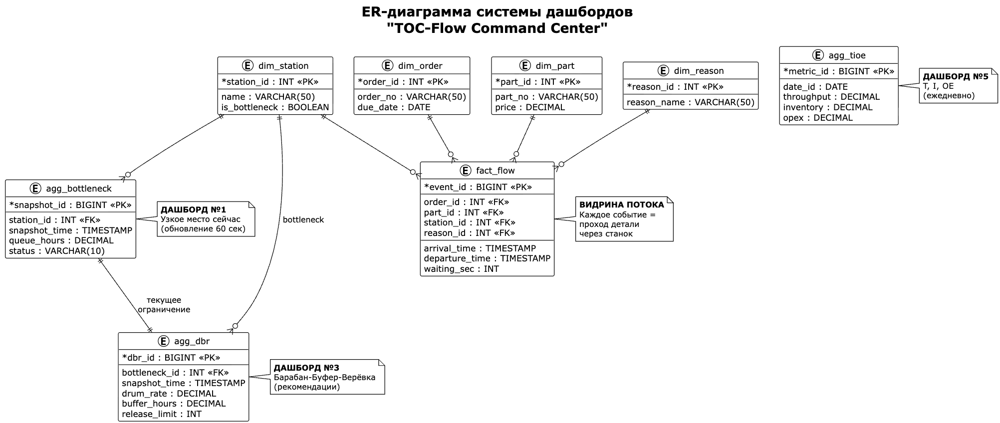
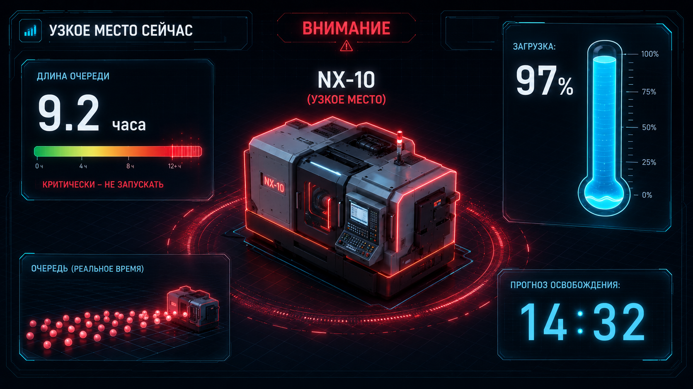
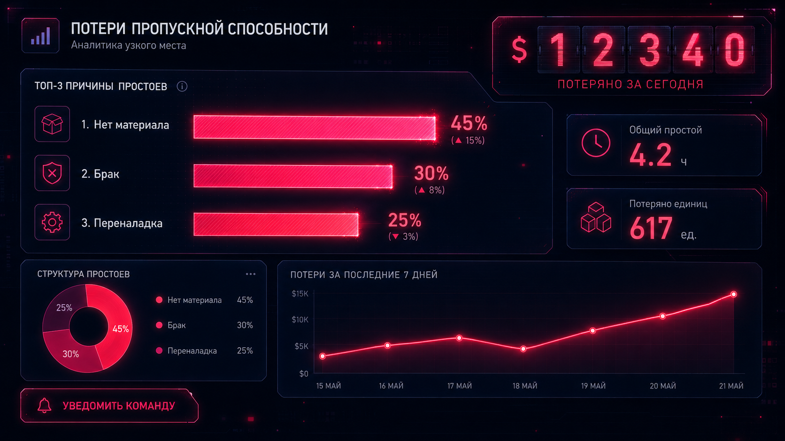
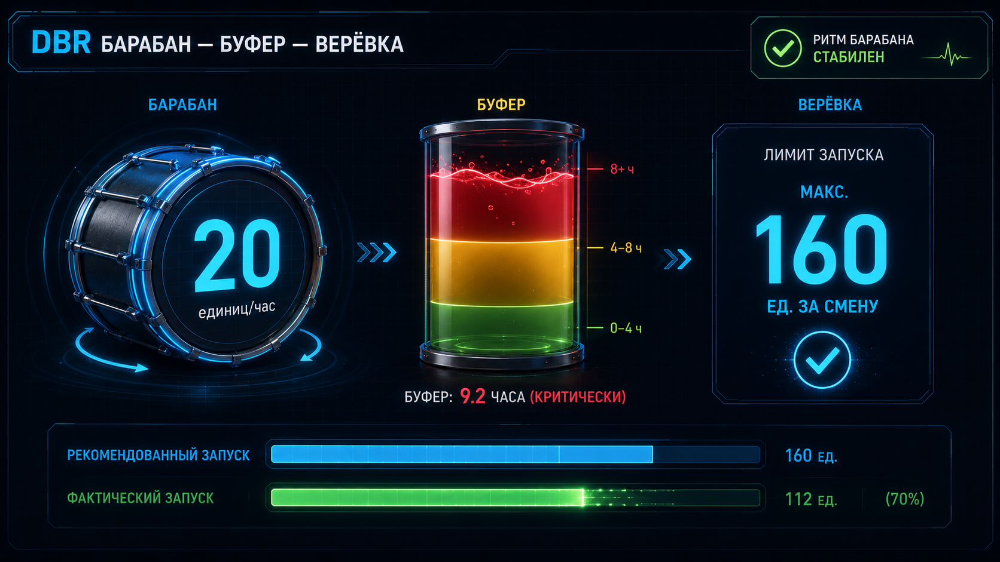
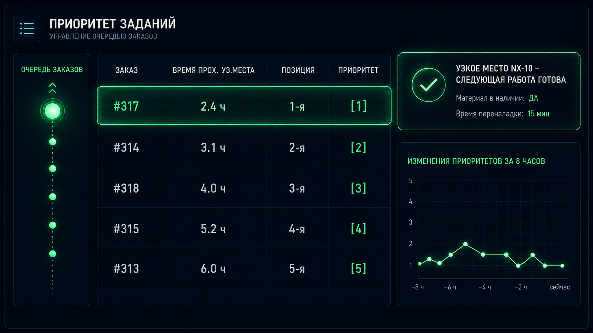
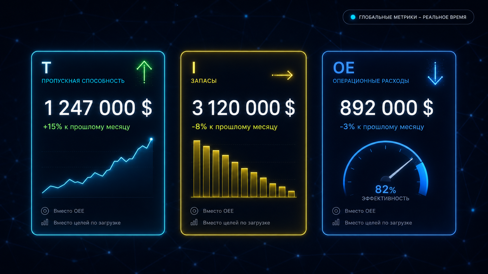
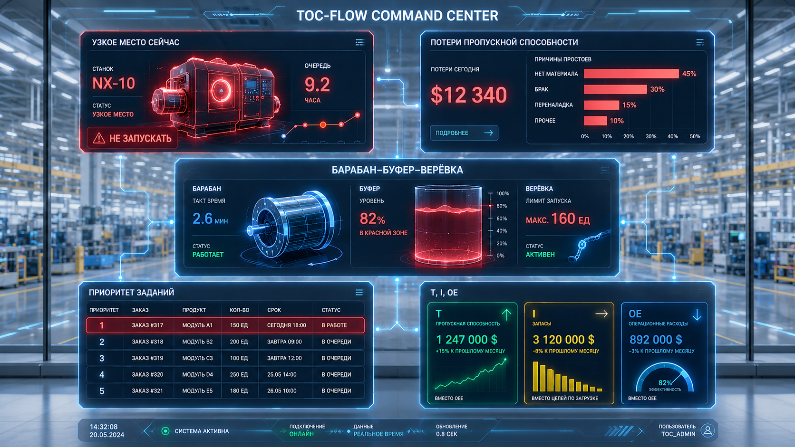
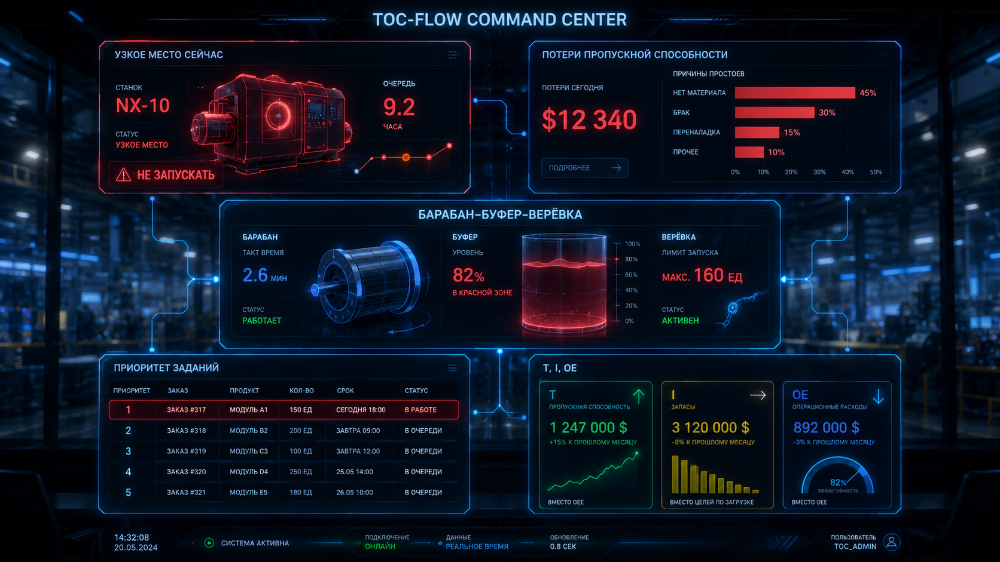

# 04. Обзор решения

**«TOC-Flow Command Center»** (центр управления потоком на основе Теории ограничений): система дашбордов и метрик для завода Алекса.

## Структура системы по слоям

| Слой | Компонент | Назначение |
|---|---|---|
| 1. Данные | Витрина «Поток заказа» | Единый источник правды: timestamp каждой детали на каждом станке |
| 2. Аналитика | 5 дашбордов + система алертов | Трансформация данных в решения |
| 3. Управление | DBR-рекомендатор + ролевые экраны | Проактивное управление ограничением |

## Распределение ролей

| Роль | Основной дашборд | Дополнительно | Устройство |
|---|---|---|---|
| Алекс (управляющий) | Бутылочное горлышко + T, I, OE | DBR, миграция bottleneck | Монитор в кабинете |
| Боб | Приоритет заданий | Потери Throughput | Планшет / экран в цехе |
| Стейси | DBR (барабан — буфер — верёвка) | Рекомендации запуска | Рабочий ПК |
| Оператор bottleneck | Дисплей «Следующее задание» | Алерты о материале | Экран на станке |
| Кладовщик | «Куда подавать материалы» | Алерты «нет материала» | Терминал на складе |
| Наладчик | Алерты простоев bottleneck | Топ-3 причины поломок | Телефон |
| Лу (бухгалтер) | T, I, OE | Детализация по продуктам | Рабочий ПК |

## Как решение реализует 5 шагов Голдратта

1. **Найти ограничение системы:** дашборд выявляет бутылочное горлышко по максимальному времени ожидания перед станцией.
2. **Подчинить всё остальное ограничению:** запуск материалов только по ритму узкого места (барабан).
3. **Повысить пропускную способность ограничения:** отчёт о простоях узкого места по причинам.
4. **Не снимать ограничение, пока не убрали инерцию:** витрина данных для проверки эффекта.
5. **Вернуться к шагу 1:** дашборд с автоматической сменой индикации при миграции ограничения.

## Дашборды

1. «Бутылочное горлышко сейчас»
2. «Потери пропускной способности»
3. «Барабан — Буфер — Верёвка» (DBR)
4. «Приоритет заданий»
5. «T, I, OE» (Throughput, Inventory, Operating Expense)

Формулы и пороги всех метрик: [05. Каталог метрик](05-metrics-catalog.md).

## ER-диаграмма системы управления

## Макеты

| Макет | Файл |
|---|---|
| Бутылочное горлышко сейчас | `assets/mockup-1-bottleneck-now.png` |
| Потери пропускной способности | `assets/mockup-2-throughput-losses.png` |
| DBR («Барабан — Буфер — Верёвка») | `assets/mockup-3-dbr.png` |
| Приоритет заданий | `assets/mockup-4-job-priority.png` |
| T, I, OE | `assets/mockup-5-tioe.png` |
| Единый центр управления (светлая тема) | `assets/mockup-command-center-light.png` |
| Единый центр управления (тёмная тема) | `assets/mockup-command-center-dark.png` |
| Интерфейс витрины «Поток заказа» | `assets/mockup-data-mart.png` |
| DBR-панель для плановика | `assets/mockup-dbr-planner.png` |
| DBR-панель для мастера (мобильная версия) | `assets/mockup-dbr-foreman-mobile.png` |

